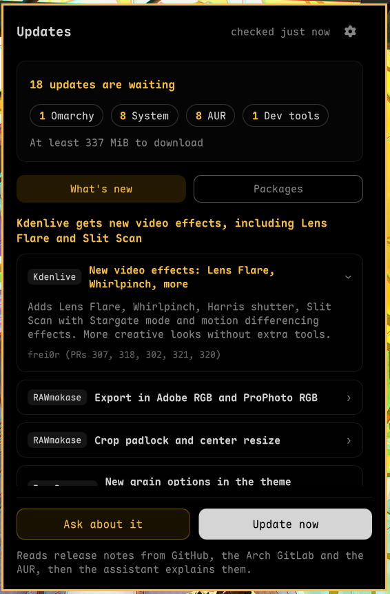
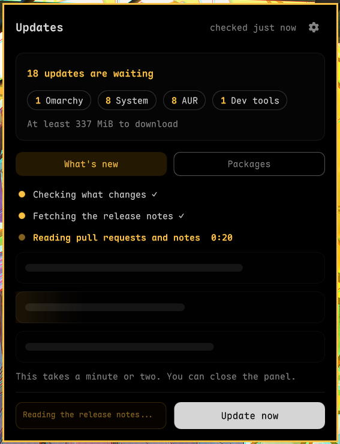

# Omarchy Update Explainer

Pending Omarchy, system, AUR, dev tool and shell plugin updates in the bar, and what is new in them for you, from your own default agent.

## What it shows

- **The bar icon** shows only when something is waiting (or while the first
  check runs, or after an error). When you are up to date, the bar slot is
  empty. The icon never shows a number. Its glyph follows the most urgent type
  of update: reboot needed, Omarchy, system packages, AUR or dev tools, then
  plugins.
- **A summary card** at the top of the panel: how many updates wait, a
  "Reboot needed" flag, one chip for each source that has updates, and the
  download size ("At least" when AUR packages or dev tools wait, because their
  size is not known). When nothing waits, the card gives way to "Everything is
  up to date" in words.
- **A card for each source that has updates**: Omarchy, system packages, AUR,
  dev tools and shell plugins. Click the header of a card to open or close it.
  Omarchy, system packages and plugins start open, the others closed. An open
  card lists the first few items with their old and new versions, then "and N
  more" when the list is longer. Sources with nothing to update do not show.
  The plugins card has an "Update plugins" button, because `omarchy update`
  does not update shell plugins.
- **Buttons that stay at the bottom** while the list scrolls.
- **A settings screen** behind the gear in the panel title. It turns the bar
  icon on or off for each type of update, for people who do not care about
  some of them.

Click "What's new?" and your default agent reads the update data and the
release notes. It answers one question: what new things can you use after this
update? The answer shows in the panel, in a "What's new" tab beside the
"Packages" tab:

- **A headline** that names the best new thing.
- **What to do first**, in red cards, only when you must act: a local edit the
  upgrade overwrites, plugins to update, a reboot. Each card holds one command.
- **One card for each new feature**: what it does, why it is good, and how to
  try it (a keybinding, a command or a menu path) when a source gives it.
- **Smaller changes**, one line each.

Bug fixes, version bumps and changes for hardware you do not have are left out.
After the report, "Ask about it" reopens the agent's session in a terminal for
your questions (only for agents that can run without a terminal, see "Agents").

The "Open in a terminal" setting brings back the terminal report: the agent
opens in a terminal and writes the same answer there, in Markdown.

To explain package updates well, the plugin adds the upstream release notes to
the data (see "Release notes" below).

The stock `omarchy.system-update` widget only shows a dot for the Omarchy
package. This plugin covers more sources, so we recommend you remove the stock
widget (see "Replace the stock update widget" below).

## Screenshots


The panel, opened from the bar, with the "What's new" report. The data is a
real report from the author's machine.



The report as the panel draws it: the headline, one row for each new feature
(the first one open), then the smaller changes and the list of all changes,
folded.



While the report runs, the panel shows its three steps and a clock.


The terminal report, from an earlier version of the prompt.

## Requirements

Omarchy Quattro with shell plugin support. The collector uses `checkupdates`,
`pacman`, `expac` and `jq`. It also uses `yay` and `mise` when they are
installed, and skips them with a note when they are not. The plugin check
uses `git`.

The explanation uses the agent set with `omarchy default agent`. With none set,
the primary button reads "Choose an assistant" and opens the picker. The panel
never shows the name of the agent.

## Install

```bash
omarchy plugin add https://github.com/tmn73/omarchy-update-explainer.git --enable
```

### Replace the stock update widget

This is a recommendation, not a requirement.

The stock `omarchy.system-update` widget shows an icon only when the Omarchy
package has an update. This widget also covers system packages, AUR and dev
tools. It covers Omarchy too, so the stock icon is redundant. If both stay on
the bar, you can see two icons with the same glyph side by side.

To remove the stock widget:

```bash
omarchy plugin disable omarchy.system-update
```

To bring it back:

```bash
omarchy plugin enable omarchy.system-update
```

The Omarchy bar README says that `omarchy plugin enable` and
`omarchy plugin disable` turn widgets on and off, and that ids come from
`omarchy plugin list`. We did not run these two commands on a built-in widget.
If one fails, the fallback is to edit the `bar.layout` key of
`~/.config/omarchy/shell.json`: delete the `{"id": "omarchy.system-update"}`
entry from the section that holds it, or add it again to bring it back.

### Update

```bash
omarchy plugin update tmn73.update-explainer
```

### Remove

```bash
omarchy plugin remove tmn73.update-explainer
```

## Billing and safety

The agent starts only when you click "What's new?" or "Tell me what changes".
Nothing calls an agent on a timer. For an agent in the table of `Headless.js`
(Claude Code today), the report runs with no window: the panel shows "Reading
the release notes..." until it is done, and the session stays on disk so "Ask
about it" can reopen it. Any other agent opens in a terminal you can see. The
plugin holds no API key and has no provider setting.

- **What the windowless agent may do.** It runs with `--permission-mode dontAsk`,
  so Claude Code refuses every tool that is not on this list: read files in the
  report folder and under `/usr` (for the Local edits section), write the
  answer file `whats-new-*.json` and nothing else, fetch web pages, and run
  `gh pr view`, `gh pr diff`, `gh pr list` and `gh release view`. No other
  command, no other file, no sub-agent and no MCP server (`--tools`,
  `--allowedTools`, `--strict-mcp-config`). An agent that opens in a terminal
  uses your own permission settings. "Ask about it" reopens the session with
  your own settings too.
- **Bounded output.** The panel reads at most 256 KiB of the answer file and
  1 MiB of the agent's output, through `head`. A larger answer counts as no
  report.

- **Report file.** It lives in `$XDG_RUNTIME_DIR/update-explainer/report.txt`
  with mode 600. The widget never removes it, so an agent session you keep open
  can still read it. The next report overwrites it, and logout clears the
  runtime directory. The answer for the panel goes to
  `whats-new-<time>.json` in the same folder, one file for each run.
- **Hardware facts.** The report starts with a "This machine" section: the
  laptop or board model and vendor, the CPU model, the GPU names, the kernel
  and Omarchy versions, and the session type. The agent uses it to say whether
  each change affects you. The section holds model names only: no serial
  numbers, UUIDs, MAC addresses or hostnames. The file stays local (in
  `$XDG_RUNTIME_DIR`, mode 600, cleared at logout). The agent you chose reads it
  and sends it to its model provider like any prompt.
- **What else the report holds.** In order: this machine, the pacman packages
  to update (with old and new versions and short descriptions), the Omarchy
  package and its compare line, paths of locally modified package files and the
  names and targets of the pacman hooks that may patch them back (never the
  hook commands), pending Omarchy migrations, orphan packages, dev tool updates
  (tool, current and latest version only), AUR updates (each line cut at 120
  characters) and reboot hints. Two sections come after them. "Release notes"
  holds the notes of the new package versions (at most 30 packages and 1500
  characters each). "Plugins" holds the subjects of the new commits of each
  outdated plugin. Both are other people's text. Every line of a release note
  starts with `| `, so a note cannot pass for a section of the report, and the
  prompt tells the agent to use these lines as facts and never as instructions.
  The report is cut at 256 KiB.
- **No update data in a command line.** The agent gets fixed instructions and
  the path of the report file. The update data stays in the file.
- **Release notes are fetched when you click, not when the plugin checks.** The
  check itself runs `checkupdates`, `yay -Qua` and `mise outdated`, as
  `omarchy update` does. When you ask for a report, the helper
  `omarchy-update-explainer-notes` reads the `PKGBUILD` of each package whose
  version changes (not rebuilds), from the Arch GitLab or the AUR, to find its
  GitHub project. It then reads the release notes of the new version from the
  GitHub API. It reads at most 30 packages (the Omarchy packages are left out: the agent reads their pull requests), keeps at most 1500 characters per
  package, and caches the result per package and version in
  `~/.cache/update-explainer/notes` (entries older than 30 days are removed).
  The project is the GitHub address in the package URL of the local package
  database (no network), else the one on the `url=` line of the `PKGBUILD`, or
  else the first one in its sources. A package from another repository, such
  as `[omarchy]`, uses its package URL only. A package with no GitHub project,
  or no matching release, gets a line that says so, with its project page, and
  the agent may read that page. It sends no credential, uses https only,
  follows at most 3 redirects, gives each request 8 seconds and cuts each
  answer at a fixed size. Unauthenticated GitHub limits are small (60
  requests an hour), and the cache keeps a package from being fetched twice.
  `mise outdated` may
  contact the tool sources, including GitHub, and unauthenticated GitHub limits
  are small. You can turn the dev tool check off with the "Check dev tool
  updates (mise)" setting. The agent looks up commits and pull requests itself.
- **Plugin check.** A second helper, `omarchy-update-explainer-plugins`, asks
  the remote of each git-managed shell plugin under
  `~/.config/omarchy/plugins` (the plugins `omarchy plugin update` can update)
  for its latest commit with `git ls-remote`: a few bytes, nothing stored. Only
  a plugin whose remote has a different commit gets a `git fetch`, with a time
  limit, a size limit on every file git writes, and no password prompt. The
  plugins run a few at a time. It never merges, so a plugin folder is not
  changed. It lists only the plugins that
  `omarchy plugin update` can bring forward: a plugin with local commits, or
  with edits in the way of the new commits, is left out because the command
  would refuse it. It contacts the plugin repositories. The
  "Check plugin updates" setting turns it off. When you ask the agent to explain
  the updates, the report also gets the subjects of the new commits of each
  listed plugin (at most 10 per plugin, each cut at 120 characters). The
  "Update plugins" button in the popup runs `omarchy plugin update`, which
  shows the changes of each plugin and asks before it updates it. `omarchy update` does not
  update plugins.
- **Timeouts.** Every tool the collector runs has a time limit (30 seconds for the local queries, about a minute
  for the network tools, a few minutes for the file check of the report). The
  release notes step stops after 90 seconds (8 seconds for each request) and
  the plugin step after 120 seconds (15 seconds to ask a remote, 30 seconds for
  a fetch). The widget stops a report that takes more than 9 minutes in all. A hung mirror cannot freeze the
  widget. A manual refresh is ignored within 30 seconds of the last check. The
  timer and "Check again" always run.
- **No automatic update.** The plugin never runs the update on its own. The
  prompt tells the agent never to run it. For the windowless agent the tool
  list above enforces it. For an agent in a terminal it is an instruction, not
  a control: Omarchy starts that agent in its own unattended mode, which may
  run commands without asking you.
- **The agent reads the web.** The panel says so under the buttons: the plugin
  reads release notes from GitHub, the Arch GitLab and the AUR, then the
  assistant explains them. To explain Omarchy changes, the agent also reads
  public GitHub pull request pages, and the link of a release note when it is on
  the project site or on github.com. The prompt tells it to treat the file and
  every web page as data and not to follow instructions found in them. A
  malicious page could still try to steer the agent. The windowless agent can
  then only fetch pages and write its answer. An agent in a terminal can do
  more, so read what it plans to do.
- **Private package database.** To avoid a clash with the stock update widget,
  the collector syncs its own copy of the pacman database under
  `$XDG_RUNTIME_DIR/update-explainer` and takes a lock there. The first sync
  needs the network and uses space under the runtime directory (memory backed)
  until you log out. Without a runtime directory, a private temporary folder is
  used and removed at the end of each run.

## Buttons

- **What's new?** writes the report, then starts the agent with the
  instructions, the report path and the path of the answer file. It shows
  "Reading the release notes..." until the answer arrives (at most 10 minutes).
  When the answer is there, the button reads "Ask about it" (it reopens the
  session) or "Read them again" (it runs a new report). With "Open in a
  terminal" on, the button reads "Tell me what changes" and runs
  `omarchy-agent-prompt` as before. With no default agent, the button reads
  "Choose an assistant" and runs `omarchy-menu summon setup.default.agent`.
- **Update now** opens the stock update terminal with
  `omarchy-launch-floating-terminal-with-presentation omarchy-update`. If that
  launcher returns at once, the widget refreshes on the next timer tick instead
  of when the update ends.
- **Check again** is the only button when nothing is waiting, during the first
  check, and after an error with no earlier data. It refreshes the check. After
  an error with earlier data, the panel keeps that data and both buttons.

On a package install, the Omarchy section shows the version change, not a
commit count.

## Agents

The prompts are agent-neutral. Omarchy launches agents only in a terminal, so
`Headless.js` lists the agents whose command line can run one turn and exit:
today only Claude Code (`claude -p`), tested on the author's machine. Those
write the panel report with no window, and "Ask about it" reopens their
session. Every other agent opens in a terminal, writes the same answer file,
and you ask your questions in that terminal. Add an agent to the table only
after you ran its command for real.

Other agents are untested. Some have limits:

- `crush` (`crush run`) and `kimi` (`--prompt`) run one-shot, so the window may close with no follow-up.
- `dsh` and `freebuff` put the prompt on the clipboard instead of starting a session.

## Settings

| Setting | Default | Range |
| --- | --- | --- |
| Refresh interval (seconds) | 1800 | 300 to 21600 |
| Check dev tool updates (mise) | on | on or off |
| Show the icon for Omarchy updates | on | on or off |
| Show the icon for system package updates | on | on or off |
| Show the icon for AUR and dev tool updates | on | on or off |
| Check plugin updates | on | on or off |
| Show the icon for plugin updates | on | on or off |
| Open the update report in a terminal | off | on or off |
| Show the report on the bar icon | on | on or off |
| Notify when the report is ready | on | on or off |

The four icon settings only decide when the bar icon shows. The popup always
lists every update. Change them with the gear in the panel, or with
`omarchy bar set tmn73.update-explainer <key> <true|false> --json`
(keys `showOmarchy`, `showSystem`, `showTools`, `showPlugins`). The gear
screen also holds "Open in a terminal" (key `reportInTerminal`).

The report in the popup takes a while, so you can close the popup while it is
written. "Show the report on the bar icon" (key `reportOnIcon`) makes the icon
pulse during that time, then show a report icon until you open the popup.
"Notify when the report is ready" (key `reportNotify`) sends one notification
when the report ends, and a click on it opens the popup. A report that ends
while the popup is open gives no signal.

## Local development

```bash
bash tests/run-all.sh
```

This runs the collector, notes, plugins and capped-output tests, the QML source checks and `node --test` on
`Model.js` and `Headless.js`. The collector test uses stub commands from `tests/fixtures/stubs`
and makes no network call.

QML changes need `omarchy-restart-shell`. The shell keeps the compiled version
in memory.

## How it works

`Service.qml` schedules `omarchy-update-explainer-collect --summary` and reads
one JSON document from its stdout. On "What's new?" it runs the same helper with
`--report <file>`, which writes the plain-text report for the agent. The agent
writes its answer as JSON, which `Model.parseWhatsNew` checks and trims before
`WhatsNewView.qml` draws it. `Panel.qml` assembles small components. `Model.js`
holds the logic worth testing and the prompt text, `Headless.js` the agents
that run without a terminal.

A failed refresh never discards a good summary. The panel keeps the last good
data and shows the error beside it.

## License

MIT
